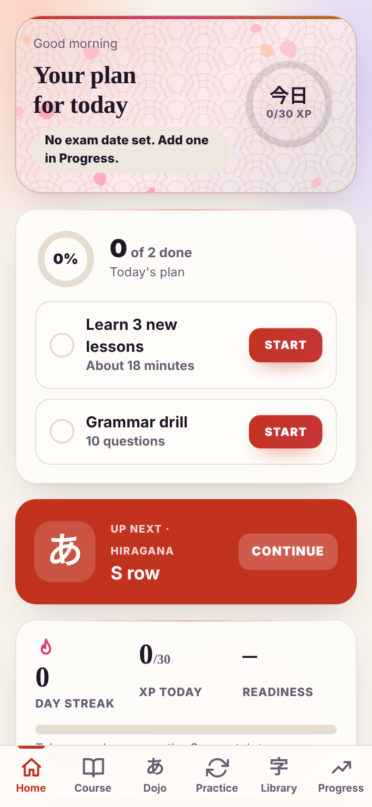
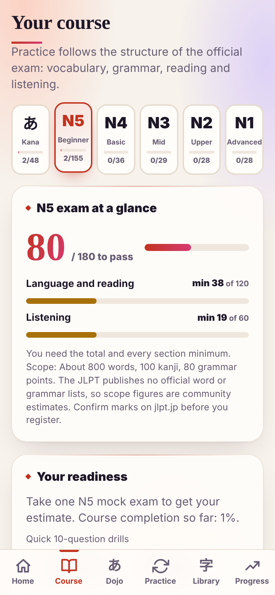
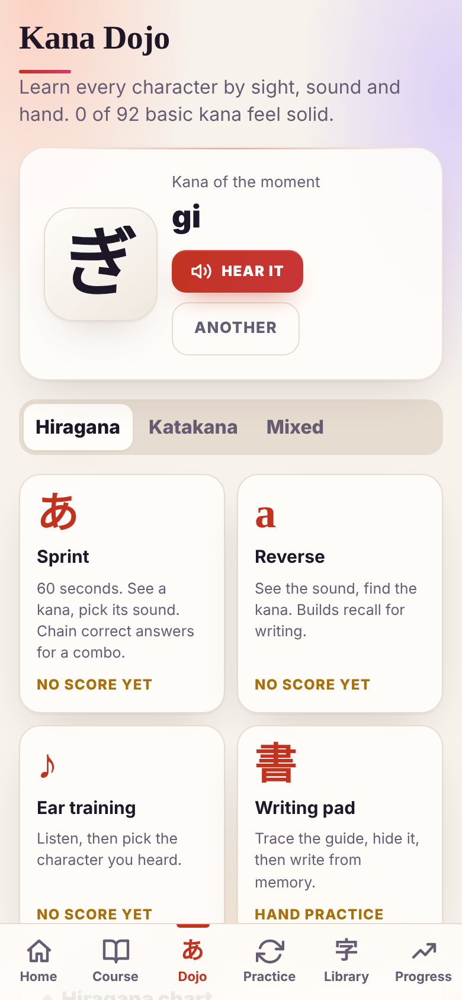

# Kotoba

A free, open-source JLPT study app that runs in the browser: kana lessons with handwriting practice, vocabulary, kanji, grammar, reading, listening, spaced-repetition review, mock exams and a readiness estimate for N5 to N1. No account, no tracking. Progress stays in your browser.

**Status.** N5 is the most complete level. N4 to N1 are starter packs (about 64 to 112 words each, plus grammar, reading and listening sets). They need more content and review. See CONTRIBUTING.md.

**Not affiliated with the Japan Foundation or the JLPT.** All questions are original and follow the official question formats. The JLPT publishes no past papers, so no official material is copied. Do not add copyrighted workbook or exam content. Pass marks and section rules are on jlpt.jp.

**Known limits.** Speech uses the browser's built-in Japanese voice, which varies by device. The readiness percentage is an estimate, not a prediction.

  

## Quick start
```
python3 build.py        # writes dist/index.html, one self-contained file
```
Open `docs/index.html` in a browser (it is the page GitHub Pages serves). See `docs/LAUNCH.md` for GitHub, LinkedIn and Play Store steps. No packages needed. Run `python3 build.py --trial` only if you want a fork with a locked free preview and access codes (`tools/make_codes.py`).

## License
Code and content: MIT (see LICENSE). Anyone may use, change and sell it, so credit is appreciated but not required.

## Layout
- `src/head.html`  page shell, base CSS, fonts
- `src/css/*.css`  extra styles, inlined in file-name order (`10-kotoba-skin.css` = brand + motion)
- `src/js/*.js`    concatenated in name order into one scope:
  - `00-core.js` helpers, icons, state (localStorage `nihongo-path-v1`), speech (`say`, `ttsText`)
  - `10-content-foundations.js` kana + first words (units shown under Course > Kana)
  - `20-content-n5.js` N5 course: vocab, kanji, grammar, reading, listening dialogues
  - `30-engine.js` exercise generators, session player, mock exams, readiness, views, events
  - `40-dojo.js` Kana Dojo (chart, memory pictures, three timed games)
  - `50-motion.js` mascot, sakura canvas, count-up, haptics
  - `99-boot.js` start-up (keep last)
- `src/tail.html` closes the page

## Adding content
- Vocabulary lesson: `LW('Title', 'jp|kana|meaning;jp|kana|meaning')`. A 4th field overrides romaji, e.g. `こんにちは||hello|konnichiwa`.
- Kanji lesson: `LK('Title','字|on-reading|meaning|kun-reading;...')`.
- Grammar lesson: `LG('Title',[tip lines],[[sentence with ＿＿,[4 options],indexOfCorrect,'why'],...])`.
- Reading: `LR('Title',jpText,english,[[question,[4 options],correctIndex],...])`.
- Listening: `LD('Title',[[ [['A','line'],['B','line']], question, [4 options], correctIndex, english ],...])`.
- Levels N5 to N1 live in `20-content-n5.js` and `21` to `24-content-n*.js`. Set `CURL=n` at the top of a level file, then build a unit array and register it in `29-registry.js`.
- Keep every question original. The JLPT publishes no past papers; only the official sample set per level on jlpt.jp.

## Official facts used (jlpt.jp results page)
Pass total / sections: N5 80 (language+reading 0-120, min 38; listening 0-60, min 19). N4 90 (same split). N3 95, N2 90, N1 100 (three sections of 0-60, min 19 each). Total 180.


## Levels N5 to N1
Each level is a units array (N5 in 20-content-n5.js, N4 to N1 in 21..24). Set `CURL=n` before building lessons so ids and `lvl` are right. `29-registry.js` registers every level in `LV` (flat lesson list, grammar, reading and listening pools). To add content, append lessons with LW, LK, LG, LR or LD in the level file and rebuild.
